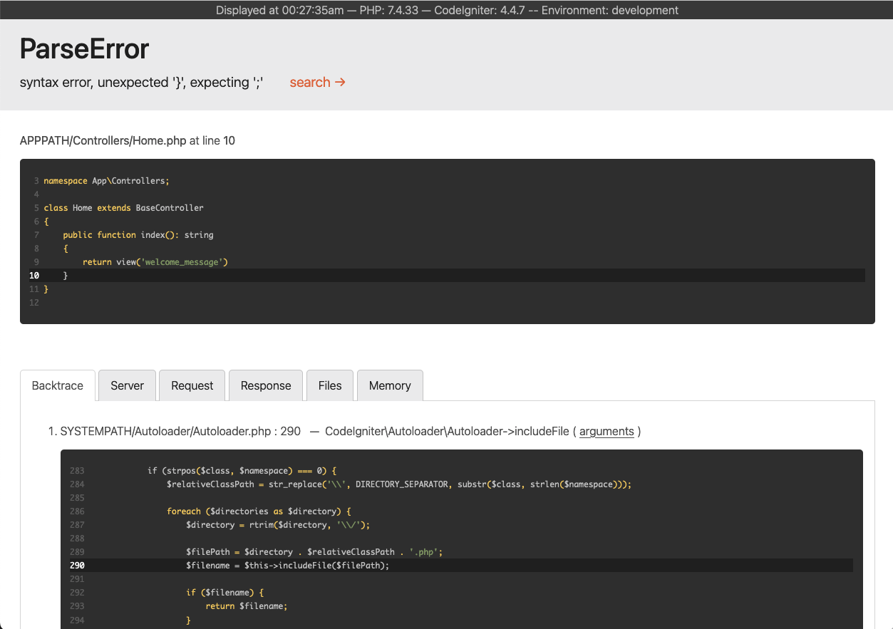

# Error Handling

CodeIgniter builds error reporting into your system through Exceptions, both the [SPL collection](https://www.php.net/manual/en/spl.exceptions.php) and a few exceptions provided by the framework.

Depending on your environment's setup, the default action when an error or exception is thrown is to display a detailed error report unless the application is running under the `production` environment. In the `production` environment, a more generic message is displayed to give your users the best experience.

## Using Exceptions

This section is a quick overview for newer programmers, or for developers who are not experienced with using exceptions.

### What are Exceptions

Exceptions are simply events that happen when the exception is "thrown". This halts the current flow of the script, and execution is then sent to the error handler which displays the appropriate error page:

```php
<?php

throw new \Exception('Some message goes here');
```

### Catching Exceptions

If you are calling a method that might throw an exception, you can catch that exception using a `try/catch` block:

```php
<?php

try {
    $user = $userModel->find($id);
} catch (\Exception $e) {
    exit($e->getMessage());
}
```

If the `$userModel` throws an exception, it is caught and the code within the catch block is executed. In this example, the script dies, echoing the error message that the `UserModel` defined.

#### Catching Specific Exceptions

In the example above, we catch any type of Exception. If we only want to watch for specific types of exceptions, like a `DataException`, we can specify that in the catch parameter. Any other exceptions that are thrown and are not child classes of the caught exception will be passed on to the error handler:

```php
<?php

use CodeIgniter\Database\Exceptions\DataException;

try {
    $user = $userModel->find($id);
} catch (DataException $e) {
    // do something here...
}
```

This can be handy for handling the error yourself, or for performing cleanup before the script ends. If you want the error handler to function as normal, you can throw a new exception within the catch block:

```php
<?php

use CodeIgniter\Database\Exceptions\DataException;

try {
    $user = $userModel->find($id);
} catch (DataException $e) {
    // do something here...

    throw new \RuntimeException($e->getMessage(), $e->getCode(), $e);
}
```

## Configuration

### Error Reporting

When `display_errors` in the PHP ini settings is enabled, CodeIgniter will display a detailed error report with all errors.

So by default, CodeIgniter will display a detailed error report in the `development` and `testing` environments, and will not display any errors in the `production` environment.



You can change your environment by setting the `CI_ENVIRONMENT` variable. See [Setting Environment](environments.md#setting-environment).

!!! important "Important"
    Disabling error reporting DOES NOT stop logs from being written if there are errors.

!!! warning "Warning"
    Note that your settings from the **.env** file are added to `$_SERVER` and `$_ENV`. As a side effect, this means that if the detailed error report is displayed, **your secure credentials are publicly exposed**.

### Logging Exceptions

By default, all Exceptions other than "404 - Page Not Found" exceptions are logged. This can be turned on and off by setting the `$log` value of **app/Config/Exceptions.php**:

```php
<?php

namespace Config;

use CodeIgniter\Config\BaseConfig;

class Exceptions extends BaseConfig
{
    // ...
    public bool $log = true;
    // ...
}
```

To ignore logging on other status codes, you can set the status code to ignore in the same file:

```php
<?php

namespace Config;

use CodeIgniter\Config\BaseConfig;

class Exceptions extends BaseConfig
{
    // ...
    public array $ignoreCodes = [404];
    // ...
}
```

!!! note "Note"
    It is possible that logging still will not happen for exceptions if your current [Log settings](logging.md#configuration) are not set up to log `critical` errors, which all exceptions are logged as.

### Logging Deprecation Warnings

!!! success "Available from version 4.3.0"

Prior to v4.3.0, all errors reported by `error_reporting()` were thrown as an `ErrorException` object.

But with the surge in use of PHP 8.1+, many users may see exceptions thrown for [passing null to non-nullable arguments of internal functions](https://wiki.php.net/rfc/deprecate_null_to_scalar_internal_arg).

To ease the migration to PHP 8.1, starting with v4.3.0, CodeIgniter has the feature that only logs the deprecation errors (`E_DEPRECATED` and `E_USER_DEPRECATED`) without throwing them as exceptions.

By default, CodeIgniter will only log deprecations without throwing exceptions in the development environment. In the production environment, no logging is done and no exceptions are thrown.

#### Configuration

The settings for this feature are as follows. First, make sure your copy of `Config\Exceptions` is updated with the two new properties and set as follows:

```php
<?php

namespace Config;

use CodeIgniter\Config\BaseConfig;
use Psr\Log\LogLevel;

class Exceptions extends BaseConfig
{
    // ...
    public bool $logDeprecations = true; // If set to false, an exception will be thrown.
    // ...
    public string $deprecationLogLevel = LogLevel::WARNING; // This should be one of the log levels supported by PSR-3.
    // ...
}
```

Next, depending on the log level you set in `Config\Exceptions::$deprecationLogLevel`, check whether the logger threshold defined in `Config\Logger::$threshold` covers the deprecation log level. If not, adjust it accordingly.

```php
<?php

namespace Config;

use CodeIgniter\Config\BaseConfig;

class Logger extends BaseConfig
{
    // ...
    // This must contain the log level (5 for LogLevel::WARNING) corresponding to $deprecationLogLevel.
    public $threshold = (ENVIRONMENT === 'production') ? 4 : 9;
    // ...
}
```

After that, subsequent deprecations will be logged as configured without being thrown as exceptions.

This feature also works with user deprecations:

```php
<?php

@trigger_error('Do not use this class!', E_USER_DEPRECATED);
// Your logs should contain a record with a message like: "[DEPRECATED] Do not use this class!"
```

When testing your application, you may want to always throw on deprecations. You may configure this by setting the environment variable `CODEIGNITER_SCREAM_DEPRECATIONS` to a truthy value.

## Framework Exceptions

### Exception Design

Starting with v4.6.0, all Exception classes that the framework throws:

- implement `CodeIgniter\Exceptions\ExceptionInterface`
- extend `CodeIgniter\Exceptions\LogicException` or `CodeIgniter\Exceptions\RuntimeException`

!!! note "Note"
    The framework only throws the above kinds of exception classes, but PHP or other libraries that are used may throw other exceptions.

There are two base Exception classes that the framework throws:

### LogicException

`CodeIgniter\Exceptions\LogicException` extends `\LogicException`. This exception represents an error in the program logic. This kind of exception should lead directly to a fix in your code.

### RuntimeException

`CodeIgniter\Exceptions\RuntimeException` extends `\RuntimeException`. This exception is thrown if an error that can only be found at runtime occurs.

The following framework exceptions are also available:

### PageNotFoundException

This is used to signal a 404, Page Not Found error:

```php
<?php

use CodeIgniter\Exceptions\PageNotFoundException;

$page = $pageModel->find($id);

if ($page === null) {
    throw PageNotFoundException::forPageNotFound();
}
```

You can pass a message into the exception that will be displayed in place of the default message on the 404 page.

For the default 404 view file location, see [HTTP Status Code and Error Views](#http-status-code-and-error-views).

If, in **app/Config/Routing.php** or **app/Config/Routes.php**, you have specified a [404 Override](../incoming/routing.md#404-override), that will be called instead of the standard 404 page.

### ConfigException

This exception should be used when the values from the configuration class are invalid, or when the config class is not the right type, etc:

```php
<?php

throw new \CodeIgniter\Exceptions\ConfigException();
```

This provides an exit code of 3.

### DatabaseException

This exception is thrown for database errors, such as when the database connection cannot be created, or when it is temporarily lost:

```php
<?php

throw new \CodeIgniter\Database\Exceptions\DatabaseException();
```

This provides an exit code of 8.

### RedirectException

!!! note "Note"
    Since v4.4.0, the namespace of `RedirectException` has been changed. Previously it was `CodeIgniter\Router\Exceptions\RedirectException`. The previous class has been removed in v4.6.0.

This exception is a special case allowing for overriding of all other response routing and forcing a redirect to a specific URI:

```php
<?php

throw new \CodeIgniter\HTTP\Exceptions\RedirectException($uri);
```

`$uri` is a URI path relative to baseURL. You can also supply a redirect code to use instead of the default (`302`, "temporary redirect"):

```php
<?php

throw new \CodeIgniter\HTTP\Exceptions\RedirectException($uri, 301);
```

Also, since v4.4.0, an object of a class that implements ResponseInterface can be used as the first argument. This solution is suitable for cases where you need to add additional headers or cookies in the response.

```php
<?php

$response = service('response')
    ->redirect('https://example.com/path')
    ->setHeader('Some', 'header')
    ->setCookie('and', 'cookie');

throw new \CodeIgniter\HTTP\Exceptions\RedirectException($response);
```

## Specify HTTP Status Code in Your Exception

!!! success "Available from version 4.3.0"

Since v4.3.0, you can specify the HTTP status code by having your Exception class implement `CodeIgniter\Exceptions\HTTPExceptionInterface`.

When an exception implementing `HTTPExceptionInterface` is caught by CodeIgniter's exception handler, the Exception code will become the HTTP status code.

## HTTP Status Code and Error Views

The exception handler displays the error view corresponding to the HTTP status code, if one exists.

For example, `PageNotFoundException` implements the `HTTPExceptionInterface`, so its exception code `404` will be the HTTP status code. Therefore, if it is thrown, the system will show the **error_404.php** in the **app/Views/errors/html** folder when it is a web request. If it is invoked via CLI, the system will show the **error_404.php** in the **app/Views/errors/cli** folder.

If there is no view file corresponding to the HTTP status code, **production.php** or **error_exception.php** will be displayed.

!!! note "Note"
    If `display_errors` is on in the PHP ini settings, **error_exception.php** is selected and a detailed error report is displayed.

You should customize all of the error views in the **app/Views/errors/html** folder for your site.

You can also create error views for specific HTTP status codes. For example, if you want to create an error view for "400 Bad Request", add **error_400.php**.

!!! warning "Warning"
    If an error view file with the corresponding HTTP status code exists, the exception handler will display that file regardless of the environment. You must implement the view file in such a way that it does not display detailed error messages in the production environment.

## Specify Exit Code in Your Exception

!!! success "Available from version 4.3.0"

Since v4.3.0, you can specify the exit code by having your Exception class implement `CodeIgniter\Exceptions\HasExitCodeInterface`.

When an exception implementing `HasExitCodeInterface` is caught by CodeIgniter's exception handler, the code returned from the `getExitCode()` method will become the exit code.

## Custom Exception Handlers

!!! success "Available from version 4.4.0"

If you need more control over how exceptions are displayed, you can now define your own handlers and specify when they apply.

### Defining the New Handler

The first step is to create a new class which implements `CodeIgniter\Debug\ExceptionHandlerInterface`. You can also extend `CodeIgniter\Debug\BaseExceptionHandler`. This class includes a number of utility methods that are used by the default exception handler. The new handler must implement a single method: `handle()`:

```php
<?php

namespace App\Libraries;

use CodeIgniter\Debug\BaseExceptionHandler;
use CodeIgniter\Debug\ExceptionHandlerInterface;
use CodeIgniter\HTTP\RequestInterface;
use CodeIgniter\HTTP\ResponseInterface;
use Throwable;

class MyExceptionHandler extends BaseExceptionHandler implements ExceptionHandlerInterface
{
    // You can override the view path.
    protected ?string $viewPath = APPPATH . 'Views/exception/';

    public function handle(
        Throwable $exception,
        RequestInterface $request,
        ResponseInterface $response,
        int $statusCode,
        int $exitCode,
    ): void {
        $this->render($exception, $statusCode, $this->viewPath . "error_{$statusCode}.php");

        exit($exitCode);
    }
}
```

This example defines the minimum amount of code typically needed: display a view and exit with the proper exit code. However, the `BaseExceptionHandler` provides a number of other helper functions and objects.

### Configuring the New Handler

Telling CodeIgniter to use your new exception handler class is done in the **app/Config/Exceptions.php** configuration file's `handler()` method:

```php
<?php

namespace Config;

use CodeIgniter\Config\BaseConfig;
use CodeIgniter\Debug\ExceptionHandler;
use CodeIgniter\Debug\ExceptionHandlerInterface;
use Throwable;

class Exceptions extends BaseConfig
{
    // ...

    public function handler(int $statusCode, Throwable $exception): ExceptionHandlerInterface
    {
        return new ExceptionHandler($this);
    }
}
```

You can use any logic your application needs to determine whether it should handle the exception, but the two most common are checking the HTTP status code or the type of exception. If your class should handle it, then return a new instance of that class:

```php
<?php

namespace Config;

use CodeIgniter\Config\BaseConfig;
use CodeIgniter\Debug\ExceptionHandlerInterface;
use CodeIgniter\Exceptions\PageNotFoundException;
use Throwable;

class Exceptions extends BaseConfig
{
    // ...

    public function handler(int $statusCode, Throwable $exception): ExceptionHandlerInterface
    {
        if (in_array($statusCode, [400, 404, 500], true)) {
            return new \App\Libraries\MyExceptionHandler($this);
        }

        if ($exception instanceof PageNotFoundException) {
            return new \App\Libraries\MyExceptionHandler($this);
        }

        return new \CodeIgniter\Debug\ExceptionHandler($this);
    }
}
```
