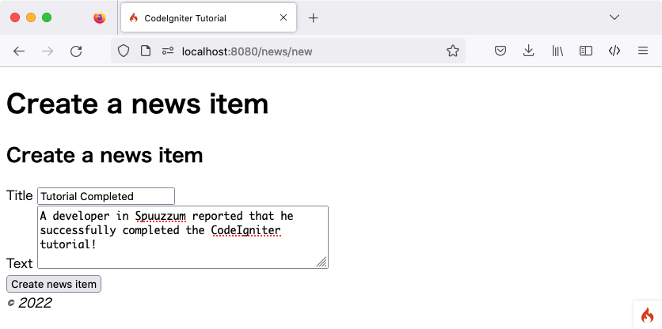
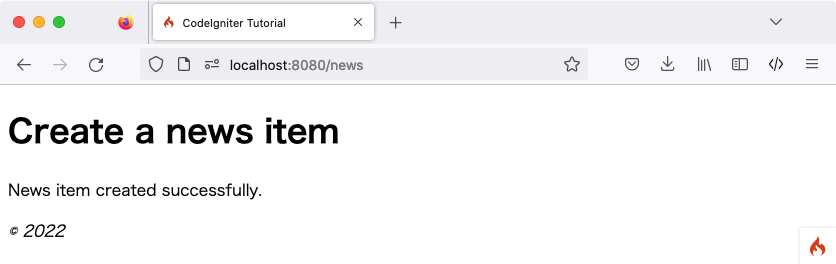

# Create News Items

You now know how you can read data from a database using CodeIgniter, but you haven't written any information to the database yet. In this section, you'll expand your news controller and model created earlier to include this functionality.

## Enable CSRF Filter

Before creating a form, let's enable the CSRF protection.

Open the **app/Config/Filters.php** file and update the `$methods` property like the following:

```php
<?php

namespace Config;

use CodeIgniter\Config\BaseConfig;

class Filters extends BaseConfig
{
    // ...

    public array $methods = [
        'POST' => ['csrf'],
    ];

    // ...
}
```

It configures the CSRF filter to be enabled for all **POST** requests. You can read more about the CSRF protection in the [Security](../../libraries/security.md) library.

!!! warning "Warning"
    In general, if you use `$methods` filters, you should [disable Auto Routing (Legacy)](../../incoming/routing.md#use-defined-routes-only) because [Auto Routing (Legacy)](../../incoming/routing.md#auto-routing-legacy) permits any HTTP method to access a controller. Accessing the controller with a method you don't expect could bypass the filter.

## Adding Routing Rules

Before you can start adding news items into your CodeIgniter application, you have to add an extra rule to the **app/Config/Routes.php** file. Make sure your file contains the following:

```php
<?php

// ...

use App\Controllers\News;
use App\Controllers\Pages;

$routes->get('news', [News::class, 'index']);
$routes->get('news/new', [News::class, 'new']); // Add this line
$routes->post('news', [News::class, 'create']); // Add this line
$routes->get('news/(:segment)', [News::class, 'show']);

$routes->get('pages', [Pages::class, 'index']);
$routes->get('(:segment)', [Pages::class, 'view']);
```

The route directive for `'news/new'` is placed before the directive for `'news/(:segment)'` to ensure that the form to create a news item is displayed.

The `$routes->post()` line defines the route for a POST request. It matches only a POST request to the URI path **/news**, and it maps to the `create()` method of the `News` class.

You can read more about different routing types in [Setting Routing Rules](../../incoming/routing.md#setting-routing-rules).

## Create a Form

### Create news/create View File

To input data into the database, you need to create a form where you can input the information to be stored. This means you'll be needing a form with two fields, one for the title and one for the text. You'll derive the slug from our title in the model.

Create a new view at **app/Views/news/create.php**:

```php
<h2><?= esc($title) ?></h2>

<?= session()->getFlashdata('error') ?>
<?= validation_list_errors() ?>

<form action="/news" method="post">
    <?= csrf_field() ?>

    <label for="title">Title</label>
    <input type="input" name="title" value="<?= set_value('title') ?>">
    <br>

    <label for="body">Text</label>
    <textarea name="body" cols="45" rows="4"><?= set_value('body') ?></textarea>
    <br>

    <input type="submit" name="submit" value="Create news item">
</form>
```

There are probably only four things here that look unfamiliar.

The `session()` function is used to get the Session object, and `session()->getFlashdata('error')` is used to display the error related to CSRF protection to the user. However, by default, if a CSRF validation check fails, an exception will be thrown, so it does not work yet. See [Redirection on Failure](../../libraries/security.md#redirection-on-failure) for more information.

The `validation_list_errors()` function provided by the [Form Helper](../../helpers/form_helper.md) is used to report errors related to form validation.

The `csrf_field()` function creates a hidden input with a CSRF token that helps protect against some common attacks.

The `set_value()` function provided by the [Form Helper](../../helpers/form_helper.md) is used to show old input data when errors occur.

### News Controller

Go back to your `News` controller.

#### Add News::new() to Display the Form

First, create a method to display the HTML form you have created.

```php
<?php

namespace App\Controllers;

use App\Models\NewsModel;
use CodeIgniter\Exceptions\PageNotFoundException;

class News extends BaseController
{
    // ...

    public function new()
    {
        helper('form');

        return view('templates/header', ['title' => 'Create a news item'])
            . view('news/create')
            . view('templates/footer');
    }
}
```

We load the [Form helper](../../helpers/form_helper.md) with the `helper()` function. Most helper functions require the helper to be loaded before use.

Then it returns the created form view.

#### Add News::create() to Create a News Item

Next, create a method to create a news item from the submitted data.

You're going to do three things here:

1.  Check whether the submitted data passed the validation rules.
2.  Save the news item to the database.
3.  Return a success page.

```php
<?php

namespace App\Controllers;

use App\Models\NewsModel;
use CodeIgniter\Exceptions\PageNotFoundException;

class News extends BaseController
{
    // ...

    public function create()
    {
        helper('form');

        $data = $this->request->getPost(['title', 'body']);

        // Checks whether the submitted data passed the validation rules.
        if (! $this->validateData($data, [
            'title' => 'required|max_length[255]|min_length[3]',
            'body'  => 'required|max_length[5000]|min_length[10]',
        ])) {
            // The validation fails, so returns the form.
            return $this->new();
        }

        // Gets the validated data.
        $post = $this->validator->getValidated();

        $model = model(NewsModel::class);

        $model->save([
            'title' => $post['title'],
            'slug'  => url_title($post['title'], '-', true),
            'body'  => $post['body'],
        ]);

        return view('templates/header', ['title' => 'Create a news item'])
            . view('news/success')
            . view('templates/footer');
    }
}
```

The code above adds a lot of functionality.

##### Retrieve the Data

First, we use the [IncomingRequest](../../incoming/incomingrequest.md) object `$this->request`, which is set in the controller by the framework.

We get the necessary items from the **POST** data sent by the user and set them in the `$data` variable.

##### Validate the Data

Next, you'll use the Controller-provided helper function [validateData()](../../incoming/controllers.md#this-validatedata) to validate the submitted data. In this case, the title and body fields are required and have length limits.

CodeIgniter has a powerful validation library as demonstrated above. You can read more about the [Validation library](../../libraries/validation.md).

If the validation fails, we call the `new()` method you just created and return the HTML form.

##### Save the News Item

If the validation passed all the rules, we get the validated data by [$this->validator->getValidated()](../../libraries/validation.md#getting-validated-data) and set them in the `$post` variable.

The `NewsModel` is loaded and called. This takes care of passing the news item into the model. The [save()](../../models/model.md#save) method handles inserting or updating the record automatically, based on whether it finds an array key matching the primary key.

This contains a new function `url_title()`. This function - provided by the [URL helper](../../helpers/url_helper.md) - strips down the string you pass it, replacing all spaces with dashes (`-`) and making sure everything is in lowercase characters. This leaves you with a nice slug, perfect for creating URIs.

##### Return Success Page

After this, view files are loaded and returned to display a success message. Create a view at **app/Views/news/success.php** and write a success message.

This could be as simple as:

```
<p>News item created successfully.</p>
```

## NewsModel Updating

The only thing that remains is ensuring that your model is set up to allow data to be saved properly. The `save()` method that was used will determine whether the information should be inserted or if the row already exists and should be updated, based on the presence of a primary key. In this case, there is no `id` field passed to it, so it will insert a new row into its table, `news`.

However, by default the insert and update methods in the Model will not actually save any data because it doesn't know what fields are safe to be updated. Edit the `NewsModel` to provide it a list of updatable fields in the `$allowedFields` property.

```php
<?php

namespace App\Models;

use CodeIgniter\Model;

class NewsModel extends Model
{
    protected $table = 'news';

    protected $allowedFields = ['title', 'slug', 'body'];
}
```

This new property now contains the fields that we allow to be saved to the database. Notice that we leave out the `id`? That's because you will almost never need to do that, since it is an auto-incrementing field in the database. This helps protect against Mass Assignment Vulnerabilities. If your model is handling your timestamps, you would also leave those out.

## Create a News Item

Now point your browser to your local development environment where you installed CodeIgniter and add **/news/new** to the URL. Add some news and check out the different pages you made.





## Congratulations

You just completed your first CodeIgniter4 application!

The diagram underneath shows your project's **app** folder, with all of the files that you created or modified.

```none
app/
├── Config
│   ├── Filters.php (Modified)
│   └── Routes.php  (Modified)
├── Controllers
│   ├── News.php
│   └── Pages.php
├── Models
│   └── NewsModel.php
└── Views
    ├── news
    │   ├── create.php
    │   ├── index.php
    │   ├── success.php
    │   └── view.php
    ├── pages
    │   ├── about.php
    │   └── home.php
    └── templates
        ├── footer.php
        └── header.php
```
